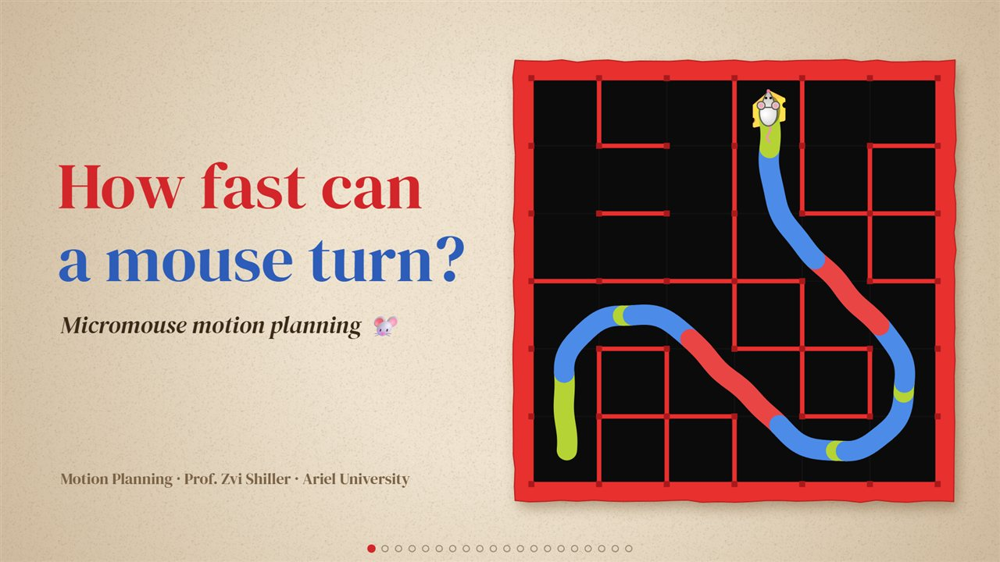
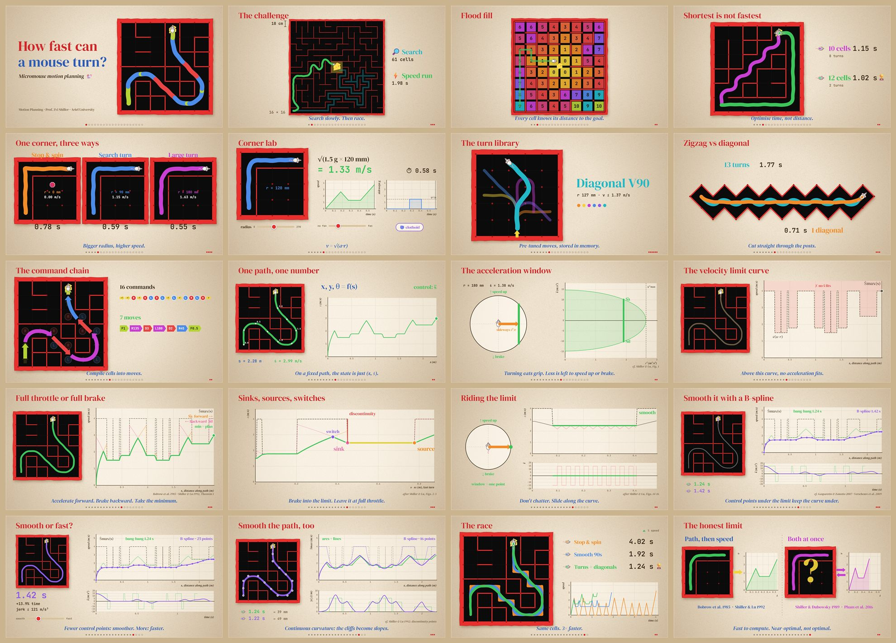
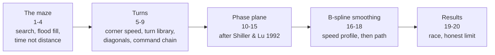
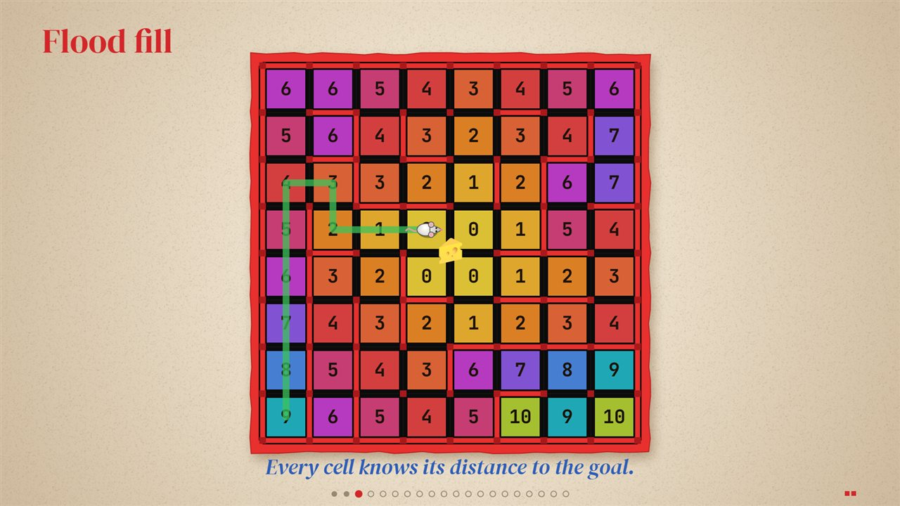
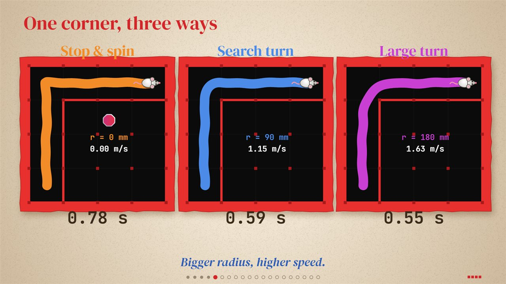
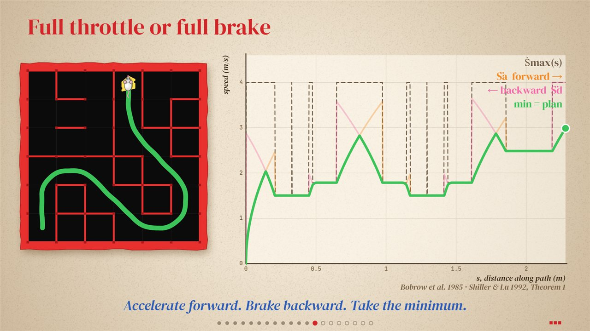
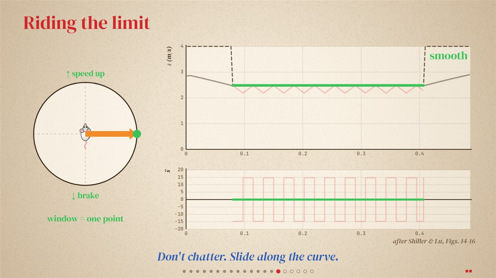
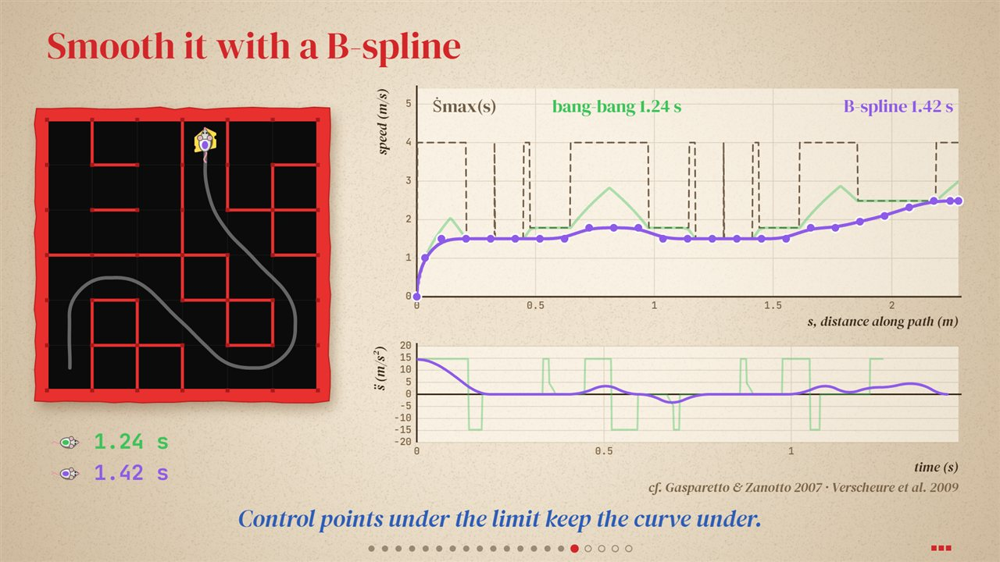
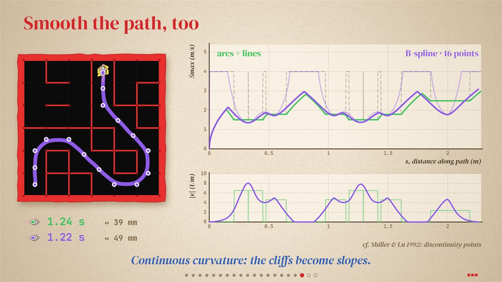

# How fast can a mouse turn?

**Micromouse motion planning, explained with moving pictures.**
An interactive talk for the *Motion Planning* course of **Prof. Zvi Shiller**, Mechanical Engineering and Mechatronics, Ariel University.
By Noam Gibor.



A micromouse is a palm-sized robot that finds the centre of a maze and then races there in about a second. Finding the path is the easy part. This talk is about the hard part: **what shape every turn should have, and how fast the mouse may go along it.** It walks from flood fill and turn libraries to the phase-plane view of time-optimal motion along a path, following Shiller and Lu (1992), and ends with B-spline smoothing of both the speed profile and the path.

## Run it

Open [`index.html`](index.html) in a browser. It is one self-contained file (vanilla JavaScript and Canvas 2D, no build step). Everything is computed live in the page: paths, flood fill, speed plans and timers.

| Key | Action |
|---|---|
| `→` `Space` click | next build, then next scene |
| `←` | previous build or scene |
| `R` | replay the current scene |
| `N` | speaker notes, with derivations and course links |
| `F` | fullscreen |
| `#7.3` in the URL | open scene 7 at build 3 |
| `?final` in the URL | show every animation at its last frame (also used for `prefers-reduced-motion`) |

Fonts come from Google Fonts. Offline, the deck falls back to Georgia and Consolas, so open it once with internet before presenting.

## The whole talk on one page





| # | Scene | The idea on screen | Course link / source |
|---|---|---|---|
| 1 | How fast can a mouse turn? | a mouse runs the maze, trail coloured by move | trajectory = path + velocity profile (L1) |
| 2 | The challenge | slow online search, then a fast offline run on a 16×16 maze | online vs offline (L1) |
| 3 | Flood fill | distance wave from the goal; click to add walls and re-flood | Bellman, Dijkstra from G (L2-L3) |
| 4 | Shortest is not fastest | fewer cells with many turns loses to more cells with straights | optimal = time, not distance (L1) |
| 5 | One corner, three ways | stop and spin, 90 mm and 180 mm arcs, timed side by side | v = √(a·r) |
| 6 | Corner lab | radius, grip and clothoid controls, live speed and sideways-force graphs | |
| 7 | The turn library | six pre-tuned moves from one entry cell | path-velocity decomposition (L1, L3) |
| 8 | Zigzag vs diagonal | 13 turns vs one straight line through the posts | C-space, (x, y, θ) (L2) |
| 9 | The command chain | 16 F/R/L commands compile into 7 library moves | |
| 10 | One path, one number | on a fixed path the state is just (s, ṡ) | Shiller & Lu 1992 §2; Kant & Zucker 1986 |
| 11 | The acceleration window | friction circle → admissible s̈ at each speed | Shiller & Lu 1992 Fig. 1 |
| 12 | The velocity limit curve | Ṡmax(s), with cliffs where curvature jumps | Shiller & Lu 1992 Eq. 8 |
| 13 | Full throttle or full brake | forward and backward integration, take the minimum | Bobrow et al. 1985; Shin & McKay 1985 |
| 14 | Sinks, sources, switches | switching structure at the last turn | Shiller & Lu 1992 Figs. 2-3 |
| 15 | Riding the limit | singular arcs: slide along the curve instead of chattering | Shiller & Lu 1992 Figs. 14-16 |
| 16 | Smooth it with a B-spline | ṡ² as a cubic B-spline; control points under the limit | Gasparetto & Zanotto 2007; Verscheure et al. 2009 |
| 17 | Smooth or fast? | slider: number of control points vs time and jerk | |
| 18 | Smooth the path, too | B-spline path: continuous curvature, no cliffs in Ṡmax | discontinuity points, Shiller & Lu 1992 |
| 19 | The race | same cells, three motion plans, about 3× apart | |
| 20 | The honest limit | path-then-speed vs optimising both | Shiller & Dubowsky 1989; Pham et al. 2017 |

## Highlights

<table>
<tr>
<td width="50%"><br><b>Flood fill.</b> Dijkstra opened from the goal: every cell gets its distance, then the mouse rolls downhill.</td>
<td width="50%"><br><b>One corner, three ways.</b> Bigger radius, higher corner speed: 0.78 s, 0.59 s, 0.55 s.</td>
</tr>
<tr>
<td><br><b>Full throttle or full brake.</b> The time-optimal speed under the velocity limit curve.</td>
<td><br><b>Riding the limit.</b> Singular arcs: smooth instead of chattering commands.</td>
</tr>
<tr>
<td><br><b>B-spline speed profile.</b> Finite jerk for +14% time with 25 control points.</td>
<td><br><b>B-spline path.</b> Continuous curvature: 1.22 s instead of 1.24 s, and 49 mm from the walls instead of 39 mm.</td>
</tr>
</table>

## What is computed

All numbers on the slides come from the planner in the page, with grip a = 1.5 g, top speed 4 m/s, cells of 180 mm.

- **Paths.** Polylines through cell centres or cell-edge midpoints, filleted with arcs (`buildPath`). Edge midpoints turn zigzags into diagonals automatically.
- **Speed along a path** (`topp`). Velocity limit `ṡ ≤ min(v_top, √(a/κ))`; forward pass at full acceleration, backward pass at full braking, take the minimum. Grip is shared through the friction circle `s̈² + (κṡ²)² ≤ a²`. Spins take `2√(θ/α)`.
- **Flood fill.** Breadth-first search from the goal over the wall set; the search run re-floods with only the walls it has sensed.
- **B-spline speed profile** (`bsplinePlan`). b(s) = ṡ² as a clamped cubic B-spline. The convex hull property turns `b ≤ Ṡmax²` into one bound per control point; the derivative property turns `|s̈| ≤ a` into a bound on neighbouring control points. Time falls when any control point rises, so the optimum is the largest feasible control points (a forward and backward pass over them). The friction circle is enforced by an outer re-solve loop.
- **B-spline path** (`splinePath`). Cubic B-spline whose control polygon is the corridor centreline, resampled every 150 mm. Curvature is continuous, so Ṡmax(s) has slopes instead of cliffs.

| Result | Time |
|---|---|
| Stop and spin | 4.02 s |
| Smooth 90° turns (r = 90 mm) | 1.92 s |
| Large turns + diagonals, bang-bang | 1.24 s |
| Same path, B-spline speed profile, 25 control points | 1.42 s (finite jerk) |
| B-spline path, bang-bang speed | 1.22 s |

The model is deliberately simple: point mass, one grip number, perfect tracking. The last scene and the notes say so.

## How it was built

This is a side project made with an AI coding assistant ("vibe coding"). The design brief that steered it is [`context/CLAUDE.md`](context/CLAUDE.md): one idea per scene, a strict text budget, the visual style of the Veritasium video, and physics that must come from the planner, not hard-coded numbers.

The project went through six versions, from a text-heavy web page to the current 20-scene deck. See [`iterations/`](iterations/README.md) for the history with pictures, and the git tags `v2` to `v6`.

## Repository layout

```
index.html               the talk (current version, v6)
context/CLAUDE.md        design brief: storyboard, visual language, physics, course mapping
context/reference_v2.html  v2, the earlier text-heavy page whose physics code was reused
iterations/              snapshots and screenshots of every version
docs/screenshots/        one image per scene + contact sheet
docs/REFERENCES.md       full references (Prof. Shiller's papers first)
docs/references.bib      the same in BibTeX
tools/make-screenshots.ps1  regenerates docs/screenshots with headless Edge
```

## References

Full list with links: [`docs/REFERENCES.md`](docs/REFERENCES.md) and [`docs/references.bib`](docs/references.bib).

**Prof. Zvi Shiller**
- Z. Shiller and H.-H. Lu, "Computation of path constrained time optimal motions with dynamic singularities," *ASME J. Dynamic Systems, Measurement, and Control*, 1992. The backbone of scenes 10 to 15 and 18.
- Z. Shiller and S. Dubowsky, "Robot path planning with obstacles, actuator, gripper, and payload constraints," *Int. J. Robotics Research*, 1989. Scene 20.
- Z. Shiller and S. Dubowsky, "On computing the global time-optimal motions of robotic manipulators in the presence of obstacles," *IEEE Trans. Robotics and Automation*, 1991.
- Z. Shiller and Y.-R. Gwo, "Dynamic motion planning of autonomous vehicles," *IEEE Trans. Robotics and Automation*, 1991.

**Also cited:** Bobrow, Dubowsky and Gibson 1985 · Shin and McKay 1985 · Kant and Zucker 1986 · Pham 2014 · Pham et al. 2017 · Gasparetto and Zanotto 2007 · Verscheure et al. 2009.

**Inspiration:** Veritasium, ["The Fastest Maze-Solving Competition On Earth"](https://www.youtube.com/watch?v=ZMQbHMgK2rw) (the turn-library segment around 16:00).
