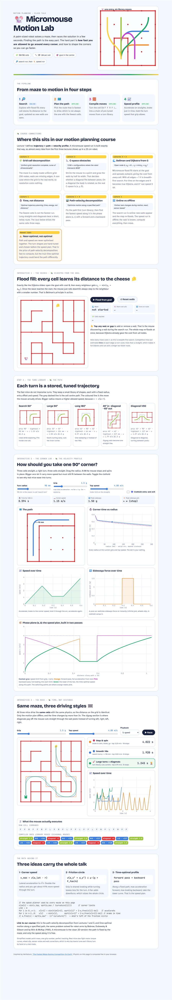
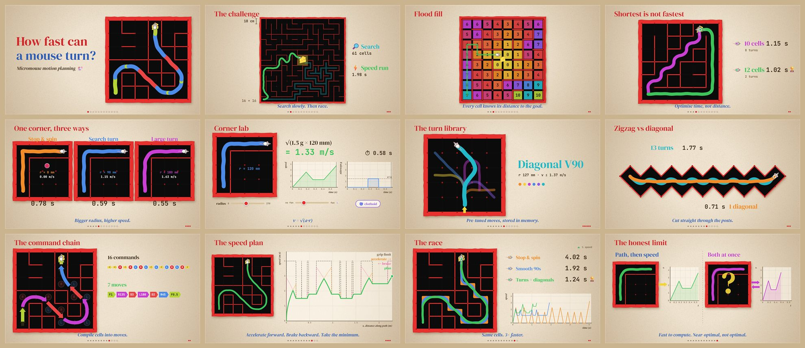
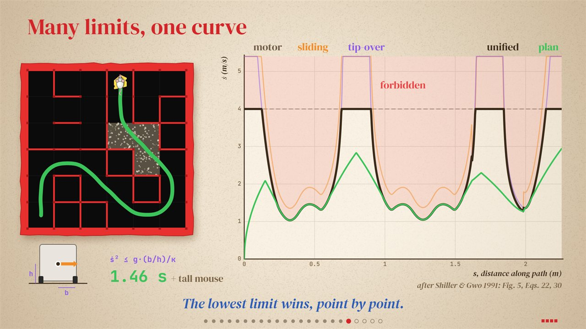

# Iterations

How the talk got from a text-heavy web page to a 20-scene animated deck. Every version that still exists is here, and git tags `v2` to `v6` mark them in the history.

| Version | What it was | Files |
|---|---|---|
| v1 | First attempts: text-heavy pages with cards. | not preserved |
| v2 | "Micromouse Motion Lab": one scrolling lab-notebook page with live experiments. The physics worked; the format did not. | [`../context/reference_v2.html`](../context/reference_v2.html), [screenshot](v2-text-page.jpg) |
| v3 | First scene-by-scene deck, built from the brief in [`../context/CLAUDE.md`](../context/CLAUDE.md): 12 scenes, Veritasium look, physics reused from v2. | [screenshots](v3-first-deck/) (source was edited in place, so only images remain) |
| v4 | Phase-plane sequence after Shiller and Lu (1992): 6 new scenes, derivations in the speaker notes, 17 scenes in total. | [`v4-phase-plane.html`](v4-phase-plane.html) |
| v5 | B-spline speed profile: "Smooth it with a B-spline" and the "Smooth or fast?" slider. 19 scenes. | [`v5-bspline-speed.html`](v5-bspline-speed.html) |
| v6 | B-spline path: "Smooth the path, too". 20 scenes. | [`v6-bspline-path.html`](v6-bspline-path.html) |
| v7 | Three scenes after Shiller and Gwo (1991): unified velocity limit curve, path optimisation with time as the cost, global search then polish. 23 scenes. **Current.** | [`../index.html`](../index.html), [screenshots](../docs/screenshots/) |

## v2: one long page

Everything was correct and interactive, but the screen repeated what the speaker says: cards, paragraphs, stat tiles. The lesson became rule #1 of the brief: *visuals do the talking*, with a title of 6 words or fewer and one caption line of 12 words or fewer per scene. The physics (`buildPath`, `midPoly`, `topp`, flood fill) carried over to every later version.

## v3: the first deck

Full-screen 16:9 scenes on parchment, black maze boards with red walls, thick colourful paths, a mouse sprite, builds on each arrow press. First review fixes: boards no longer collide with titles, flood-fill walls got a dark outline, the search maze got fewer loops so the search wanders, and the command chain merges 45° fillets into library moves (R135, L180).

## v4: the phase plane

Scenes 10 to 15 were added between the command chain and the race: *One path, one number*, *The acceleration window*, *The velocity limit curve*, *Full throttle or full brake*, *Sinks, sources, switches*, *Riding the limit*. They follow Shiller and Lu (1992) figure by figure, and the speaker notes carry the derivations with lecture-slide pointers.

## v5: B-spline speed profile

The bang-bang profile is time-optimal, but its acceleration jumps (infinite jerk). The speed plan b(s) = ṡ² became a cubic B-spline, with the control points as the variables. The convex hull keeps it under the velocity limit curve, and its derivative bounds the acceleration. A first attempt split grip into separate sideways and forward limits and reached 1.96 g. It was replaced by a loop that re-solves until the 1.5 g friction circle holds everywhere.

| Control points | Time | Peak jerk |
|---|---|---|
| 7 | 1.62 s | 89 m/s³ |
| 25 | 1.42 s | 121 m/s³ |
| 71 | 1.32 s | about 2200 m/s³ |
| bang-bang | 1.24 s | infinite |

## v6: B-spline path

Lines plus arcs make curvature jump, which puts cliffs into the velocity limit curve. A cubic B-spline path on the corridor centreline (one control point every 150 mm) has continuous curvature. It came out faster and safer: 1.22 s instead of 1.24 s, and 49 mm from the nearest wall instead of 39 mm. Spacing matters: one control point every 60 mm gives 1.51 s.

## v7: time as the cost (Shiller and Gwo 1991)

Prof. Shiller's paper on autonomous vehicles uses exactly this B-spline path, and goes one step further: it optimises the control points with the motion time along the path as the cost. Three scenes follow it:

- **Many limits, one curve** (Fig. 5). Sliding, tip-over and the motor each give a velocity limit; the plan stays under the lowest. On a flat floor the paper's tip-over inequality (Eq. 30) reduces to `ṡ² ≤ g·(b/h)/κ`. A dusty patch (mobility η = 0.5) costs 1.22 → 1.29 s; a tall mouse makes tip-over dominate, 1.46 s.
- **Time is the cost** (Fig. 6, Eqs. 35-36). A live pattern search moves the control points; a penalty counts samples inside the walls grown by half the track. 1.22 s → 1.15 s in 574 evaluations.
- **Search, then polish** (Figs. 7, 11-12). 38 maze routes, smoothed with the cell centres as control points, filtered by a one-cell tube down to three distinct candidates, each polished. The best goes from 1.07 s to 0.70 s, because the optimised spline cuts across the open parts of the maze.

Supporting changes: the planner (`topp`) accepts a per-point grip factor and an extra speed cap, and `chart` accepts a lower y limit. Both default to the old behaviour.

